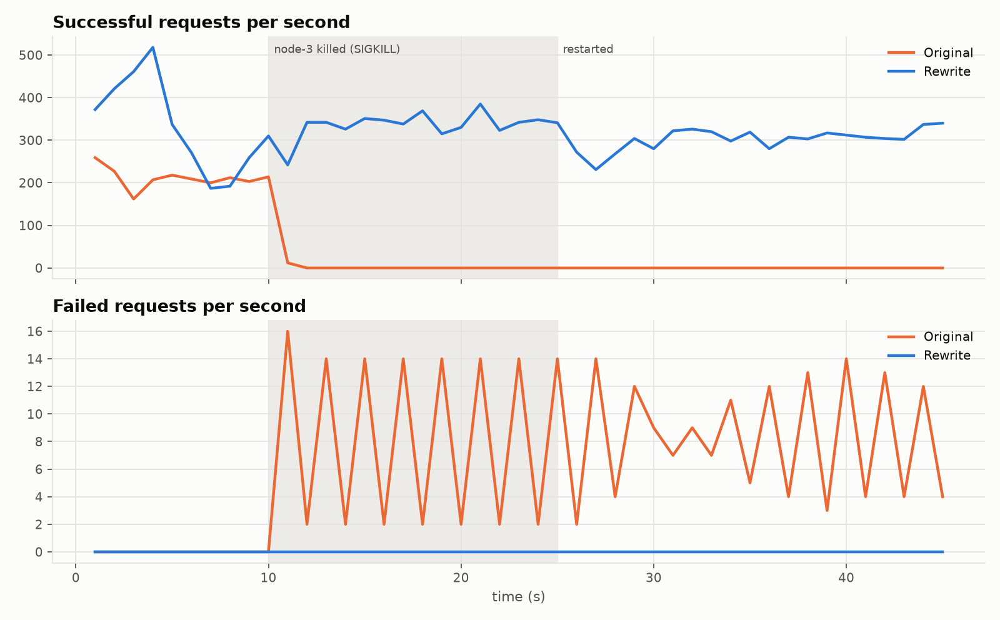

# Bug audit of the original implementation

Audit of the code at commit `eebab5b` (before the rewrite), what each problem
caused, and how it was fixed. Each fix is pinned by a regression test where
one is possible. Commit hashes refer to this repository's history.

Items are numbered in the order they were found; #35 was found last but is
the most severe.

**Baseline:** the original `test_server.py` (58 tests) does not finish. With
no per-test timeout it was still running after 15 minutes. With a 30 s
per-test timeout it ends at **21 failed / 37 passed** after 212 s, and the
37 passing tests include many whose assertions are `pass` or are guarded by
`if`. The replacement suite has 160+ tests and runs in about 25 s.

## The most severe one

**#35: one node crash permanently deadlocks the rest of the cluster.**
Found by experiment E4, which kills a node under load. In the original
`server.py`, `_send_forward_put` checks whether a replica is down *while
holding* `self.lock`, and if so calls `_store_hint`, which does
`with self.lock:` again. `self.lock` is a plain, non-reentrant
`threading.Lock`, so the first write after any node is marked DOWN blocks
forever while holding the lock that every request handler and the gossip
loop need.

Evidence from the E4 run (`experiments/E4_failure_recovery/original/logs`):
on both surviving nodes the last request handled is followed by
`SKIP PUT → node-3 (DOWN)` and then nothing: no `HINT STORED` line (printed
right after the nested `with self.lock`), no further gossip, no recovery
after node-3 restarts. Successful requests drop to zero within 2 s of the
crash and never come back:

The rewrite holds no lock across calls into other locking code or across
RPCs ([DESIGN.md, concurrency model](DESIGN.md#concurrency-model)). Under
the same experiment it serves every request through the crash and the
restart. This bug also explains why many original tests hit the 30 s
timeout.

## Correctness

| # | Problem | Effect | Fix | Regression test |
|---|---|---|---|---|
| 1 | Every write was appended to `store[key]` and written to a **new file**; nothing was ever pruned. | Memory, disk usage, restart time and GET payload size grew with the number of writes, not keys. | Reconcile on write; one atomically replaced file per key. | `test_storage.py::test_versions_do_not_accumulate`, `test_replication.py::test_storage_does_not_grow_with_updates` |
| 2 | Two concurrent PUTs on the same coordinator read the same clock and both wrote `{node: k+1}` with different values. | Two different values with **identical** vector clocks; replicas could not order them. | Dotted version vectors + a durable per-node write counter ([DESIGN](DESIGN.md#versioning-dotted-version-vectors)). | `test_conflicts.py::test_concurrent_writes_on_one_coordinator_are_never_lost_or_colliding` |
| 3 | (Found while fixing #2.) With plain vector clocks, a write from a **stale context** through the same coordinator dominates a newer write it never saw. | Silent lost update. | Dotted version vectors: A supersedes B only if A's context contains B's dot. | `test_conflicts.py::test_stale_context_does_not_overwrite_newer_value`, `test_versioning.py::TestDottedVersionVectors` |
| 5 | Clock entries were serialised in dict insertion order; read repair and de-duplication compared `str(context)`. | Equal clocks were treated as different versions: spurious repairs and duplicate siblings. | Canonical (sorted) serialisation; versions compared by `(value, canonical clock, dot)`. | `test_vector_clock.py::test_serialization_is_canonical` |
| 6 | The client's context in `PutRequest` was ignored; the coordinator always read and merged every replica's clock. | Clients could not resolve siblings deliberately, or write based on what they had read. | Honour the supplied context; only blind (context-less) writes read first. | `test_conflicts.py::test_write_with_merged_context_resolves_siblings` |
| 7 | Hinted handoff ran **inside the Gossip RPC handler**, with 3 attempts × 4 s timeouts and sleeps. | A slow delivery stalled membership exchange, which could cause false failure detections. | Separate delivery loop that only targets live nodes, with per-target mutual exclusion. | `test_hinted_handoff.py` |
| 8 | Hints were held only in memory. | A restart of the node holding hints lost the writes destined for the failed replica. | Persistent `HintStore`, reconciled per (target, key). | `test_hinted_handoff.py::test_hints_survive_standin_restart` |
| 9 | Delivered hints were removed by matching `(key, timestamp_ms)`. | A new hint for the same key in the same millisecond could be deleted undelivered. | Delete exactly the delivered versions by identity. | `test_storage.py::test_discard_removes_only_given_versions` |
| 10 | `PutHint` RPC existed but was never called; a dead replica's write was just counted as a failure. | No sloppy quorum: writes failed whenever 2 of a key's 3 replicas were down, even with healthy nodes elsewhere. | Sloppy quorum with stand-in nodes beyond the top N. | `test_hinted_handoff.py::test_standin_holds_hint_and_hands_it_back`, experiment E3 |
| 11 | Storage kept a separate `_keys.txt` map (`hash=key` per line), rewritten in full for every new key; on load, unmapped hashes were "auto-healed" by naming the key after its hash. | O(n²) writes; keys containing `=` or newlines broke; data could reappear under the wrong key. | The key is stored inside its record. | `test_storage.py::test_reload_from_disk` (unicode + newline key) |
| 12 | Storage paths were relative to the current directory (`data/<node>`). | Running from another directory silently used a different (empty) data set. | `--data-dir` option; tests use temp dirs. | all integration tests |

## Membership and failure handling

| # | Problem | Effect | Fix | Regression test |
|---|---|---|---|---|
| 13 | Restarted nodes always used generation 1, while `leave_node.py` set the generation to the current Unix time. | A node that had left could **never rejoin**. | Generation = process start time. | `test_membership.py::test_leave_removes_node_from_ring_and_restart_rejoins` |
| 14 | Gossip only contacted peers marked UP. | Two nodes that marked each other DOWN (e.g. after a blip) never spoke again: a permanent partition. | Probe a random dead node with p=0.25 each round. | `test_membership.py::test_partitioned_nodes_heal` |
| 15 | Liveness compared the peer's wall-clock `last_updated_time` with the local clock. | Clock skew between machines caused false or missed failure detections. | Track when the heartbeat last *advanced*, on the local monotonic clock. | `test_membership.py` (unit, with fake clocks) |
| 16 | Peers listed in the initial ring started as DOWN. | Nothing was replicated to them until gossip happened to reach them. | Nodes join through seeds and are only added once heard from. | `test_membership.py::test_all_nodes_discover_each_other_via_seeds` |
| 17 | `--seed` join sent one Gossip RPC and **discarded the reply**; a joiner that started before its seed never joined. | Slow or failed joins. | Join retries through the seeds until a live peer is known, and merges replies. | `test_membership.py::test_new_node_joins_ring` |
| 18 | Any node accepted any peer's claim about *its own* state. | Stale gossip could mark a live node as down in its own table. | A node only accepts a leave request for its current generation about itself. | `test_membership.py::test_self_ignores_stale_or_bogus_claims` |
| 19 | (Found during the rewrite.) gRPC enables `SO_REUSEPORT` by default. | A second process with the same port bound successfully and stole traffic; two incarnations of one node id fought forever. | `grpc.so_reuseport=0`, exit with an error, warn on duplicate ids. | `test_membership.py::test_second_process_cannot_bind_a_used_port`, `e2e::test_duplicate_port_is_rejected` |
| 20 | (Found during the rewrite.) A cached channel to a peer could still be in reconnect backoff when the peer became reachable: after a restart, or at startup when a node gossiped to a seed that was not listening yet. gRPC Python also shares connections process-wide between channels, so even a *new* channel inherited the backoff. | The first requests to a node that had just joined or recovered failed fast, the node was marked dead again, and handoff was delayed. A `leave` request sent by a client was dropped this way about 1 run in 10. | Per-channel connection pools (`grpc.use_local_subchannel_pool`), reset the channel when a peer joins or recovers, and `wait_for_ready` for the leave notice. | `test_membership.py::test_leave_removes_node_from_ring_and_restart_rejoins` (80/80 runs) |
| 34 | (Found by experiment E3.) Gossip with one random peer per second, plus judging liveness *before* the round's exchanges, let a delayed gossip thread declare live peers dead under CPU saturation. | 9-14 false "dead" verdicts per 20 s at saturation; spurious hinted writes and occasional failed requests. | Probe suspected peers directly; judge after the exchanges. | `test_membership.py::test_suspects_are_live_peers_with_stale_heartbeats`, [optimization log](../experiments/optimization_log/2026-11-06_suspicion.md) |
| 21 | The ring was mutated by the gossip thread while request threads read it, without a lock. | Possible inconsistent preference lists under churn. | Locked, copy-on-write token list. | `test_ring.py::test_concurrent_modification_and_lookup` |

## Performance and resources

| # | Problem | Effect | Fix | Evidence |
|---|---|---|---|---|
| 4 | Quorum waits polled `while len(replies) < R: sleep(0.05)`; PUT joined *every* replica thread (up to 2 s). | ~50 ms latency floor on every request; writes as slow as the slowest replica. | Futures; return as soon as R/W replicas answer. | Experiment E1 |
| 22 | A new gRPC channel per replica RPC, never closed. | TCP handshake per request and a file-descriptor leak. | Pooled channels. | Experiment E1 |
| 23 | A new thread per replica per request. | Thread creation on the hot path, unbounded under load. | Bounded fan-out thread pool. | Experiment E2 |
| 24 | Every request was logged with `print`. | I/O on the hot path; unreadable logs. | `logging` with levels; per-request logs at DEBUG. | n/a |
| 25 | gRPC's default reconnect backoff grows to 120 s. | A recovered node could stay unreachable from its peers for minutes. | Backoff capped at 1 s. | Experiment E4 |

## Tooling, tests and experiments

| # | Problem | Effect | Fix |
|---|---|---|---|
| 26 | `README.md` described a different project: a Go codebase with an HTTP API, YAML config and `go test`. | The documentation did not match the code. | Rewritten. |
| 27 | `tools/check_replica_keys.py` read `GetReply.success`, which does not exist (the field is `found`), and the exception was swallowed. | The committed hinted-handoff result reported **200/200 keys missing** for every run, regardless of what the system did. | Replaced by a replica-divergence checker that reads each replica directly (`benchmarks/run_experiments.py`, E4). |
| 28 | `bench_scaling_clients.py` always ran 20 threads and only scaled the number of operations, but plotted the result as "throughput vs clients". | The scaling chart did not measure scaling. | E2 varies real concurrency. |
| 29 | The node-failure benchmark force-removed the dead node from the ring before measuring. | It measured a healthy 2-node cluster, not failure handling. | E4 kills a node *during* the run and records a per-second timeline. |
| 30 | GET of a never-written key was counted as a failed request in benchmark CSVs. | Inflated error rates. | Benchmarks pre-load the keyspace and classify outcomes by status. |
| 31 | Shell "tests" asserted nothing and wrote ~25 output files into the repository root; generated files (`__pycache__`, logs, PID files, CSVs, PNGs) and two stale copies of the code were committed. | Noise; no signal from the tests. | pytest suite, `.gitignore`, clean tree. |
| 32 | `start_cluster_3_debug.sh` recorded the PID of a `( … \| tee … )` wrapper subshell; `stop_cluster.sh` used `pkill -f server.py`. | PID files did not identify the servers; the stop script could kill unrelated processes. | Scripts track the real server PID (`exec`). |
| 33 | `N`, `R`, `W`, timeouts and the advertised host (`localhost`) were hard-coded. | Could not run across machines or tune anything. | `NodeConfig` + CLI flags, validated at startup. |

Numbering is stable across documents, so some items appear out of order
(#4 is listed under performance, #34 under membership).

Two more performance problems were found by profiling the *rewrite* and are
recorded in [experiments/optimization_log/](../experiments/optimization_log/):
blind writes read from all N replicas instead of R, and local work went
through the RPC thread pool (+79 % saturated write throughput once fixed).
