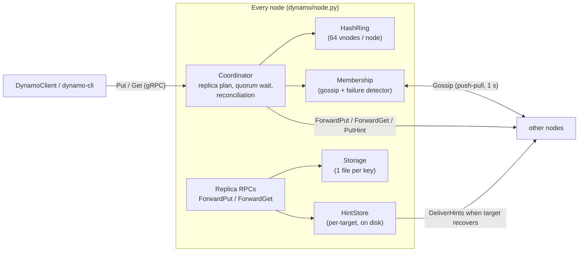
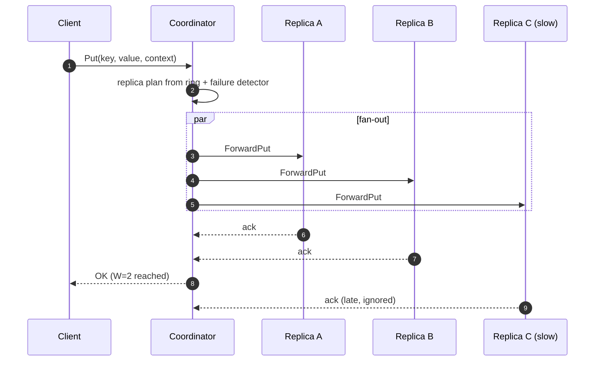
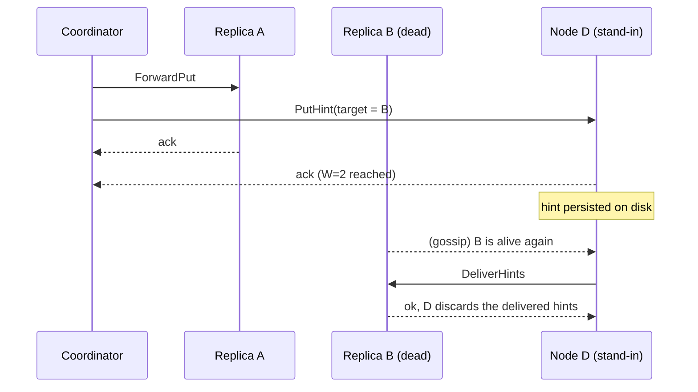

# Design

This document explains how the store works and *why* it is built this way.
It assumes familiarity with the [Dynamo paper](https://www.allthingsdistributed.com/files/amazon-dynamo-sosp2007.pdf)
(DeCandia et al., SOSP 2007); section references below point into it.

- [Components](#components)
- [Partitioning: consistent hashing](#partitioning-consistent-hashing)
- [Replication and quorums](#replication-and-quorums)
- [Versioning: dotted version vectors](#versioning-dotted-version-vectors)
- [Handling failures: sloppy quorum and hinted handoff](#handling-failures-sloppy-quorum-and-hinted-handoff)
- [Read repair](#read-repair)
- [Membership and failure detection](#membership-and-failure-detection)
- [Storage engine](#storage-engine)
- [Concurrency model](#concurrency-model)
- [What is deliberately not implemented](#what-is-deliberately-not-implemented)

## Components

| Module | Responsibility |
|---|---|
| `dynamo/ring.py` | Consistent-hash ring, preference lists |
| `dynamo/vector_clock.py`, `dynamo/versioning.py` | Causality tracking, reconciliation |
| `dynamo/storage.py` | Durable per-key storage, hint store, durable write counter |
| `dynamo/membership.py` | Gossip state, heartbeats, failure detection, join/leave |
| `dynamo/node.py` | Coordinator logic + replica RPC handlers + background loops |
| `dynamo/rpc.py` | Pooled gRPC channels between nodes |
| `dynamo/server.py` | Process entry point, CLI flags, graceful shutdown |
| `dynamo/client.py` | Client library with failover, and the CLI |
| `dynamo/proto/dynamo.proto` | Wire protocol |

There is no leader and no special node: every node runs the same code, any
node can coordinate any request, and a node joins by contacting any existing
node (a *seed*).

## Partitioning: consistent hashing

*(paper §4.2)* Each node places `vnodes` tokens on a 160-bit SHA-1 ring.
A key's **preference list** is the first N *distinct physical* nodes
clockwise from `sha1(key)`.

- **Why virtual nodes?** With one token per node, the arc each node owns
  varies wildly and a failed node's whole load lands on a single successor.
  [Experiment E5](../experiments/README.md#e5-virtual-nodes-and-load-balance)
  measures load imbalance against the vnode count. With one token per node
  the busiest of 8 nodes holds 2.5× its fair share; the default of 64 (the
  original used 10) brings that down to about 1.2×.
- **Why consistent hashing at all?** Adding a 9th node to 8 moves about 1/9
  of the keys (11.0 % measured), while `hash(key) mod N` moves 89 % (also E5).

The ring is guarded by a lock and its token list is rebuilt copy-on-write,
because the gossip thread changes membership while request threads perform
lookups.

## Replication and quorums

*(paper §4.5)* Any node receiving a client request acts as its
**coordinator**:

- The coordinator sends the operation to all N replicas **in parallel** and
  answers the client as soon as **W** (writes) or **R** (reads) have
  responded. The original implementation polled in a `sleep(0.05)` loop,
  which put a ~50 ms floor under every request, and waited for every replica
  on writes ([bug audit #4](BUG_AUDIT.md)).
- With `R + W > N` (default 3/2/2) every read quorum overlaps the most recent
  write quorum, so a read sees the latest *acknowledged* write.
- Quorum failures are reported with gRPC status `UNAVAILABLE`. A failed write
  may still have reached some replicas; as in Dynamo, it is not rolled back.
- [Experiment E3](../experiments/README.md#e3-quorum-trade-offs) measures the
  latency and availability of different (R, W) choices.

**Writes without a context.** If the client sends no context (a "blind"
write, e.g. `dynamo-cli put`), the coordinator first reads the key from R
replicas and uses the merged context, so the write supersedes what is
currently stored instead of becoming a sibling of it. Clients that read
before writing pass the context from `Get` and skip that extra round trip.

## Versioning: dotted version vectors

*(paper §4.4)* Dynamo lets replicas accept writes independently and detects
conflicts with vector clocks: version A supersedes B if A's clock is
greater than or equal to B's in every entry; otherwise they are concurrent and both are
returned to the client as **siblings**, which the client merges and writes
back with the merged context.

**The problem with plain vector clocks.** The coordinator stamps a write by
incrementing *its own* entry of the client's context. When one coordinator
handles two writes that started from the same context, e.g. two clients
that both read `{A:1}`:

| Approach | Write 1 | Write 2 | Result |
|---|---|---|---|
| Increment the context (original code) | `{A:2}` | `{A:2}` | **Collision**: two different values, identical clocks. |
| Use a per-node counter | `{A:2}` | `{A:3}` | Write 2 *dominates* write 1 although neither writer saw the other: **silent lost update**. |

The original implementation had the first behaviour. Fixing it with a unique
per-node counter produces the second, and an integration test caught that
regression (`test_stale_context_does_not_overwrite_newer_value`). Riak hit
the same problem in production and moved to **dotted version vectors**
([Preguiça et al. 2012](https://arxiv.org/abs/1011.5808)), which is what
this store implements:

- Each version carries a **dot**, `(coordinator, counter)`, that uniquely
  names the write event (`ValueWithContext.dot` in the proto), plus the
  **context** the writer had read.
- **A supersedes B iff A's context contains B's dot**
  (`A.context[B.dot.node] >= B.dot.counter`).
- Two writes from the same stale context never contain each other's dot, so
  they correctly become siblings, and a write that read both resolves them.

The per-node counter is a `DurableCounter` that reserves values in fsynced
blocks of 1000, so a dot is never reused after a restart without paying for
a disk write on every PUT.

All reconciliation goes through one function, `versioning.reconcile`, used
by replicas (on every write), coordinators (merging responses) and the hint
store.

## Handling failures: sloppy quorum and hinted handoff

*(paper §4.6)* A strict quorum would make a key unwritable whenever two of
its three replicas are down, even if the cluster has healthy nodes.

The coordinator builds a **replica plan**: it walks the full preference
list, keeps the first N nodes the failure detector considers healthy, and
replaces each dead replica in the top N with the next healthy node *beyond*
N. That stand-in stores the write in its `HintStore`, tagged with the
intended replica, and the write counts toward W.

- If there is no stand-in (e.g. a 3-node cluster with N=3), or a replica
  fails mid-request, the coordinator keeps the hint itself (it does not count
  toward W).
- Stand-ins also answer reads from their hints, so sloppy reads work too.
- A background loop delivers hints only to nodes the failure detector
  considers alive, never delivers to the same target concurrently, and
  deletes exactly the versions that were delivered (new hints that arrive
  meanwhile are kept).
- Hints are reconciled per (target, key), so 100 writes to one key while a
  replica is down become one hint, and they are persisted so a stand-in
  restart does not lose them.
- Hints for a node that **left** the cluster are re-homed to the key's new
  owners.

[Experiment E4](../experiments/README.md#e4-crash-and-recovery) kills a node
under load and measures client-visible errors and how long hinted handoff
takes to make all replicas identical again.

## Read repair

After a read reaches R replicas, the coordinator returns immediately and, in
the background, waits for the remaining replicas, reconciles everything and
writes exactly the missing versions to each stale replica. Stand-ins are not
repaired (they are not real replicas; their data arrives via handoff).

## Membership and failure detection

*(paper §4.8)* Each node gossips its full membership table to one random
live peer per second (push-pull: the peer replies with its own table).

| Field | Meaning |
|---|---|
| `generation` | Process start time (s). A restarted node always supersedes its previous life. |
| `version` | Heartbeat counter, advanced every gossip round. |
| `left` | Administrative removal (`up=false` on the wire). |

- **Failure detection.** A peer is *alive* while its `(generation, version)`
  keeps advancing. Liveness is measured on the **local monotonic clock**
  (time since we last saw it advance), so wall-clock skew between machines
  does not matter. The original compared the peer's wall-clock timestamp
  with the local one. A failed RPC with `UNAVAILABLE` also marks a peer dead
  immediately, and any newer heartbeat revives it.
- **Suspicion before death** (as in SWIM). Gossip with one random peer per
  second means a live peer's heartbeat can reach us late under load. Peers
  whose heartbeat is older than half the timeout are contacted *directly*,
  and liveness is judged only after the round's exchanges. Under saturation
  this took false "dead" verdicts from 9-14 per 20 s run to zero
  ([optimization log](../experiments/optimization_log/2026-11-06_suspicion.md)),
  and real failures are detected sooner, because the direct probe fails fast.
- **Dead nodes stay on the ring** for `remove_timeout` (2 min), so their
  key ranges do not shift around because of a transient failure; their
  writes go to stand-ins instead.
- **Partition healing.** Each round also probes a random dead node with
  probability 0.25, so two nodes that wrongly marked each other dead
  reconnect. In the original, gossip skipped dead nodes entirely, so such
  nodes never spoke again.
- **Join.** A new node gossips with its seeds until it knows a live peer.
- **Leave.** `dynamo-cli leave node-3` tells node-3 to announce `left` for its
  current generation; peers drop it from the ring at once. Restarting it
  creates a new generation, so it rejoins.
- **Self-protection.** A node ignores what others claim about it, except a
  leave request for its current generation. If peers know a *newer*
  generation of its id, it logs a warning (a second process with the same id?)
  and jumps ahead.

When a peer joins or recovers, its pooled gRPC channel is reset: the old
channel may still be waiting out a reconnect backoff (for example, because
we gossiped to it as a seed before it was listening), which made fresh
nodes flap back to dead. Channels use a local subchannel pool so that a
reset really does open a new connection.

## Storage engine

- One file per key: `sha256(key).rec`, a `StoredRecord` protobuf holding
  the key and its live versions. Updates replace the file atomically
  (`write temp` → `os.replace`), so a crash leaves the old or the new record,
  never a torn one.
- Every write is reconciled before it is stored, so a key never holds more
  than its set of concurrent siblings. The original kept every version ever
  written, in memory and as separate files.
- `--fsync` additionally fsyncs each write so it survives power loss;
  [experiment E6](../experiments/README.md#e6-cost-of-fsync) measures what
  that costs.
- Read-modify-write is serialised per key with 64 striped locks.

This favours simplicity over write throughput; a log-structured engine
(e.g. an LSM tree) would batch and sequentialise writes.

## Concurrency model

- The gRPC server runs handlers on a thread pool (32 threads).
- Coordinators fan out on a separate bounded pool (64 threads), so a
  coordinator waiting for replicas never starves the handlers that serve
  replica RPCs.
- Background work (read repair, hint delivery) runs on its own small pool and
  two daemon threads (gossip, hint loop).
- Shared state is protected by: the ring lock, the membership lock, per-key
  storage stripes, the hint-store lock and the counter lock. No lock is held
  across an RPC.

## What is deliberately not implemented

These are the honest limitations. All are well understood, and none is
needed to demonstrate the core techniques:

- **Anti-entropy with Merkle trees** (paper §4.7). Replicas converge through
  hinted handoff and read repair only. A key that is never read again after
  missing a write whose hint was lost stays stale. Also, **when a node joins,
  existing data is not streamed to it**; it receives new writes and repairs.
- **Deletes.** Deleting needs tombstones plus garbage collection to stop
  deleted values from being resurrected by stale replicas; the API has no
  delete.
- **Security.** Channels are plaintext and unauthenticated (`insecure_channel`).
- **Bounded sibling growth.** Clients that never resolve conflicts let
  sibling sets grow without limit.
- **Performance ceiling.** Python's GIL limits each node to roughly one core;
  the experiments run every node and the load generator on one 4-core laptop.
