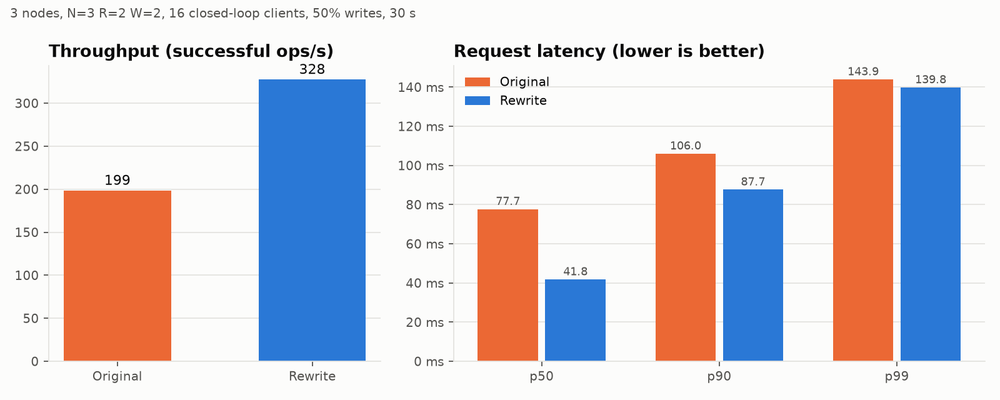
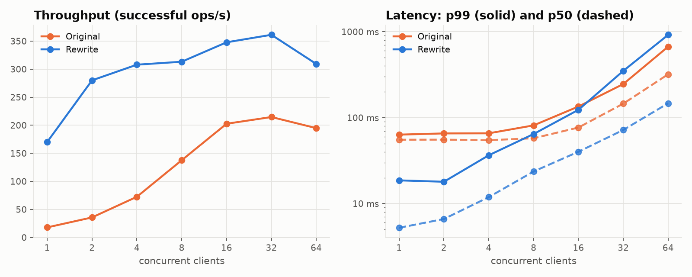
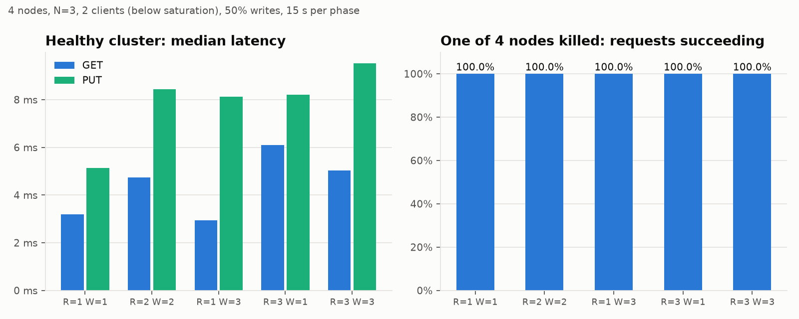
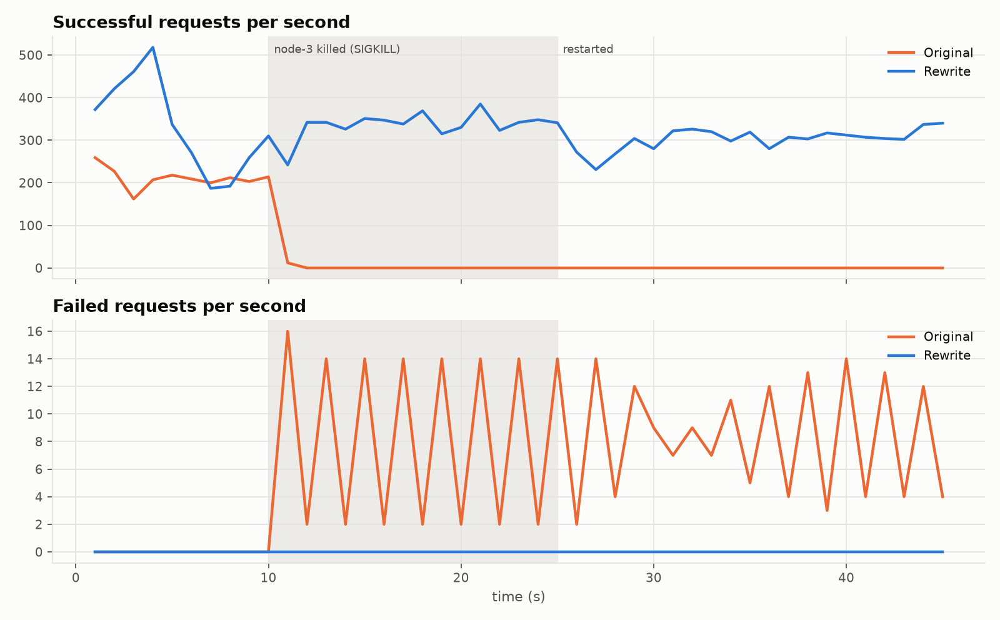
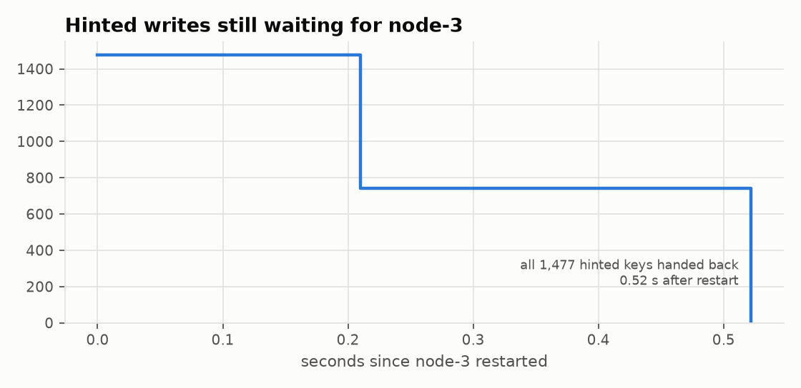
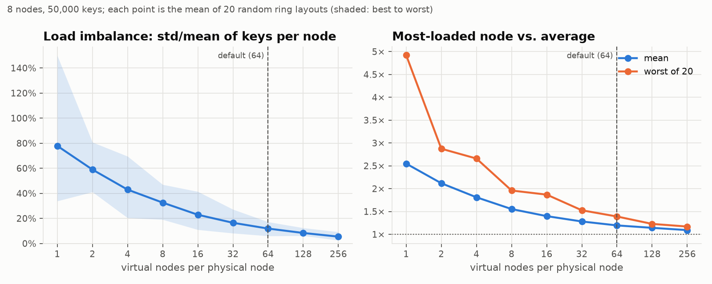
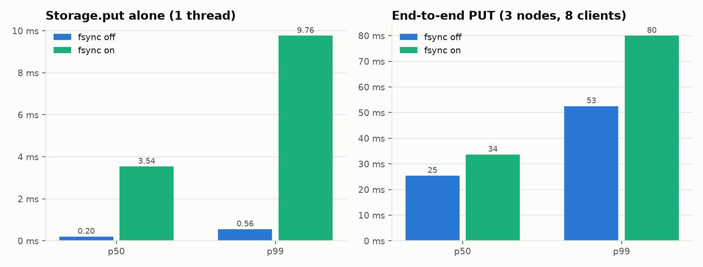

# Experiments

Every number in this repository comes from here. Each experiment states the
question, the setup, the result and what was learned. Raw data sits next to
each write-up, so every chart can be checked or re-plotted.

```bash
make experiments                              # all six, ~20 min
python -m benchmarks.run_experiments e2 e4    # a subset
make plots                                    # redraw charts from existing data
```

## Method

- **Real processes.** Every node is a separate `dynamo-server` process
  (`benchmarks/cluster.py`). Nothing is mocked.
- **Same harness for both versions.** The original implementation (commit
  `eebab5b`) is run unmodified from a git worktree. The wire protocol is
  compatible, so one load generator drives both.
- **Closed-loop load** (`benchmarks/bench.py`). Each client sends one
  request, waits for the answer and sends the next. Clients are spread over
  several processes (no client-side GIL ceiling) and round-robin over all
  coordinators, with one failover retry like `DynamoClient`. Default
  workload: 50 % PUT / 50 % GET over 1,000 pre-loaded keys, 100-byte
  values, 2 s request deadline.
- **Outcomes are classified**: ok, quorum failure, unavailable, timeout. A
  GET of a missing key is *not* an error.
- **Recorded per experiment**: `environment.json` (machine, versions, the
  git commit that produced the data), `summary.json` / `results.csv`, a
  per-second `timeline.csv`, every request in `requests.csv.gz`, and node
  log excerpts.

**Machine:** Intel i5-1235U laptop, 4 logical CPUs available to WSL2,
8 GB RAM, Python 3.12, grpcio 1.85. **The load generator and all nodes
share these 4 cores**, so absolute numbers are CPU-bound and laptop-sized.
The comparisons (original vs rewrite, configuration A vs B) are the point,
not the absolute throughput. Single-client throughput of the rewrite varied
from 170 to 218 ops/s across three full runs; the tables show the final run.

---

## E1: Original vs. rewrite

**Question.** Under identical load, how do the two implementations compare?
**Setup.** 3 nodes, N=3 R=2 W=2, 16 clients, 30 s.



| | Original | Rewrite | Change |
|---|---:|---:|---:|
| Throughput (ops/s) | 199 | 328 | **1.65×** |
| p50 latency | 77.7 ms | 41.8 ms | **1.86× lower** |
| GET p50 | 67.8 ms | 29.8 ms | 2.27× lower |
| PUT p50 | 87.4 ms | 61.4 ms | 1.42× lower |
| p99 latency | 143.9 ms | 139.8 ms | about equal |
| Failed requests | 0 / 5959 | 0 / 9827 | |

**Findings.**
- Median latency roughly halves and GET latency drops by more than half, at
  higher throughput. This is mostly the removal of the 50 ms polling loop
  and of the waits for *all* replicas ([bug audit #4](../docs/BUG_AUDIT.md)).
- p99 is about the same. At 16 clients both systems are CPU-saturated on
  this machine, and tail latency is dominated by queueing.
- The low-load picture (E2) shows the difference much more clearly.

## E2: Concurrency scaling

**Question.** How do throughput and latency change as concurrent clients
increase from 1 to 64?
**Setup.** As E1; 15 s per level. (The original "throughput vs clients"
script always ran 20 threads and only changed the number of operations, so
it never measured this: [bug audit #28](../docs/BUG_AUDIT.md).)



| Clients | Original ops/s | Rewrite ops/s | Original p50 | Rewrite p50 | Original p99 | Rewrite p99 |
|---:|---:|---:|---:|---:|---:|---:|
| 1 | 18 | 170 | 55.4 ms | 5.2 ms | 63 ms | 19 ms |
| 2 | 36 | 280 | 55.5 ms | 6.6 ms | 66 ms | 18 ms |
| 4 | 72 | 308 | 54.7 ms | 11.9 ms | 66 ms | 36 ms |
| 8 | 138 | 313 | 57.6 ms | 23.6 ms | 81 ms | 65 ms |
| 16 | 203 | 348 | 76.8 ms | 40.1 ms | 135 ms | 124 ms |
| 32 | 215 | 361 | 145.7 ms | 72.0 ms | 246 ms | 350 ms |
| 64 | 195 | 309 | 319.8 ms | 147.0 ms | 671 ms | 921 ms |

**Findings.**
- **At low load the rewrite is about 10× faster**: 5 ms vs 55 ms median
  with one client. The original's median never drops below about 55 ms
  regardless of load, which is the polling floor.
- The original's throughput grows linearly up to 8 clients only because
  each request spends most of its time *sleeping*. It then saturates at
  about 200 ops/s.
- The rewrite saturates at about 4 clients and 300-360 ops/s. Beyond that,
  extra clients only add queueing delay (Little's law: latency ≈ clients ÷
  throughput, e.g. 64 ÷ 309 ≈ 207 ms vs the measured 147 ms median / 446 ms p90).
- **Observation:** at 32-64 clients the rewrite's p99 is *worse* than the
  original's (0.9 s vs 0.7 s at 64). The rewrite pushes more requests
  through the same CPU, PUTs (two round trips) queue behind GETs, and
  nothing bounds the queue. Admission control or per-node concurrency
  limits would be the next step for a production system.

## E3: Quorum trade-offs

**Question.** What does each (R, W) choice cost in latency, and what stays
available when a node dies?
**Setup.** 4 nodes, N=3, 2 clients (below saturation, so latency reflects
waiting for replicas rather than CPU queueing), 15 s healthy, then node-4
is SIGKILLed and another 15 s runs. Failure timeout 2 s.



| R | W | R+W>N | ops/s | GET p50 | PUT p50 | p99 | failed (healthy) | failed (1 node killed) |
|---:|---:|:-:|---:|---:|---:|---:|---:|---:|
| 1 | 1 | no | 405 | 3.2 ms | 5.1 ms | 15.2 ms | 0 / 6076 | 0 / 6302 |
| 2 | 2 | yes | 278 | 4.7 ms | 8.4 ms | 19.9 ms | 0 / 4168 | 0 / 3917 |
| 1 | 3 | yes | 331 | 3.0 ms | 8.1 ms | 15.9 ms | 0 / 4967 | 0 / 4623 |
| 3 | 1 | yes | 263 | 6.1 ms | 8.2 ms | 16.2 ms | 0 / 3941 | 0 / 4018 |
| 3 | 3 | yes | 268 | 5.0 ms | 9.5 ms | 15.5 ms | 0 / 4014 | 0 / 3923 |

**Findings.**
- **GET latency follows R and PUT latency follows W**: the coordinator waits
  for the R-th or W-th fastest replica. PUT also depends on R, because a
  write without a client context first reads R replicas to find the version
  it supersedes (R=3/W=1 writes cost about as much as R=1/W=3).
- **Every configuration served 100 % of requests with a node dead**,
  including R=3/W=3, which needs *all three* replicas. Sloppy quorum makes
  this possible: the dead replica is replaced by the 4th node, which holds
  the writes as hints. A strict quorum would fail every R=3 or W=3 request
  for keys the dead node replicates.
- R=1/W=1 is the fastest but gives up R+W>N: a read can miss the latest
  acknowledged write. The default R=2/W=2 balances the two.

## E4: Crash and recovery

**Question.** What do clients see when a node crashes and comes back, and
how quickly do replicas converge afterwards?
**Setup.** 3 nodes, N=3 R=2 W=2, 16 clients, 45 s. node-3 is SIGKILLed at
t=10 s and restarted at t=25 s. Failure timeout 2 s for the rewrite (the
original's is hard-coded to 12 s).



| | Original | Rewrite |
|---|---:|---:|
| Successful requests (45 s) | 2,123 | 14,418 |
| Failed requests | 291 (265 timeout, 26 quorum_fail) | **0** |
| Successful requests after the crash (t > 12 s) | 0 | 10,506 |

**Findings.**
- **The rewrite serves every request through the crash and the restart.**
  Requests that would have gone to the dead coordinator are retried
  elsewhere by the client, and writes for its key ranges are kept as hints.
- **The original stops serving entirely about 1 s after the crash and never
  recovers, even after node-3 is back.** The node logs show why: the first
  write after node-3 is marked down re-acquires a non-reentrant lock the
  thread already holds, which freezes both surviving nodes
  ([bug audit #35](../docs/BUG_AUDIT.md#the-most-severe-one); evidence in
  `E4_failure_recovery/original/logs`).

**Convergence.** A separate run writes for 10 s while node-3 is down (no
reads, so read repair cannot help), restarts it, and times hinted handoff
from the nodes' own log timestamps. A full scan of every key on every
replica then checks the result.



| | |
|---|---:|
| Writes accepted while node-3 was down (8 clients, 10 s) | 2,665 (0 failed) |
| Hinted keys handed back (summed over the 2 nodes holding hints, each ≤ 1,000 keys) | 1,477 |
| First / last delivery after restart | 0.21 s / **0.52 s** |
| Keys whose 3 replicas still differ (full scan) | **0** |

## E5: Virtual nodes and load balance

**Question.** How many virtual nodes per physical node are needed for an
even key distribution, and how much data moves when a node joins?
**Setup.** Pure computation on the real `HashRing`: 8 nodes, 50,000 keys,
then a 9th node joins. A single ring layout is one random sample, so each
setting is averaged over 20 independent layouts.



| vnodes | Imbalance (std/mean), mean of 20 | best–worst | Busiest node vs. mean | Keys moved when a 9th node joins |
|---:|---:|---:|---:|---:|
| 1 | 77.9 % | 33.8–149.9 % | 2.55× | 11.5 % |
| 2 | 59.0 % | 41.1–80.7 % | 2.12× | 14.8 % |
| 4 | 43.0 % | 20.4–69.5 % | 1.81× | 12.2 % |
| 8 | 32.6 % | 19.1–47.0 % | 1.55× | 11.1 % |
| 16 | 22.9 % | 11.0–41.4 % | 1.40× | 10.9 % |
| 32 | 16.5 % | 8.2–27.2 % | 1.28× | 11.3 % |
| 64 | 11.9 % | 6.0–17.2 % | 1.20× | 11.0 % |
| 128 | 8.4 % | 6.1–12.4 % | 1.14× | 11.0 % |
| 256 | 5.5 % | 2.5–9.2 % | 1.09× | 11.1 % |

**Findings.**
- Imbalance falls roughly as 1/√vnodes. With one token per node the
  busiest node holds **2.5× its fair share** on average (4.9× in the worst
  layout); at 64 vnodes, 1.2×.
- The original used 10 vnodes. **64** keeps the busiest node within about
  20 % of average; 256 is only marginally better, while each membership
  change rebuilds a 4× larger token list. That is why 64 is the default.
- **A join moves 11.0 % of keys, matching the ideal 1/9 (11.1 %)**,
  independent of vnodes. Naive `hash(key) mod N` placement would move
  89.0 % of keys for the same join.

## E6: Cost of fsync

**Question.** What does making every write survive power loss (`--fsync`)
cost?
**Setup.** A single-threaded `Storage.put` micro-benchmark (2,000 writes over
500 keys, 100-byte values) isolates the disk cost; an end-to-end run
(3 nodes, 8 clients, 100 % PUT, 15 s) shows what the client sees.



| | fsync off | fsync on | Cost |
|---|---:|---:|---:|
| `Storage.put` p50 (1 thread) | 0.20 ms | 3.54 ms | 18× |
| `Storage.put` p99 | 0.56 ms | 9.76 ms | 18× |
| End-to-end PUT throughput (8 clients) | 311 ops/s | 231 ops/s | −26 % |
| End-to-end PUT p50 / p99 | 25.4 / 52.5 ms | 33.7 / 80.0 ms | +33 % / +52 % |

**Findings.**
- fsync makes the storage write itself **about 18× slower**; without it the
  atomic `os.replace` write already survives a *process* crash, just not an
  OS crash or power loss.
- End to end, the cost is diluted by RPC and CPU work (**−26 % throughput,
  +33 % median latency**), because writes to the 3 replicas fsync in
  parallel. On this machine (WSL2 virtual disk) fsync is relatively cheap;
  on a laptop SSD without a write cache, or a cloud disk, expect more.
- This is the classic group-commit opportunity: batching several writes
  per fsync, as log-structured stores do, would recover most of the loss.

## Optimization log

Changes made *because of* these measurements, each with a before/after
table:

- [Ask only R replicas before a blind write; run local work inline](optimization_log/2026-11-06_fanout.md):
  saturated write throughput +79 %, write p99 −59 %.
- [Suspect, probe, then judge](optimization_log/2026-11-06_suspicion.md):
  false failure detections under load from 9-14 per run to 0.
- Measurement fixes, found by attributing every failed request to its
  coordinator: the load generator used gRPC's default connection settings
  (a dead node could hang a request for its whole deadline) and has to use
  the same channel options as the real client (commit history,
  `fix(bench)`).
